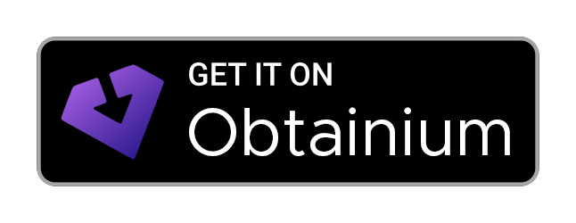

# MemoCtrl

**Your self-hosted Memos, on your phone.**

[](https://github.com/VoidedKN0X/MemoCtrl/releases/latest)  [](LICENSE)  [](https://github.com/sponsors/VoidedKN0X)

MemoCtrl is an Android app for self-hosted [Memos](https://usememos.com/) servers: capture thoughts, links and to-dos like tweeting to yourself.

Part of the [Ctrl series](#the-ctrl-series) by VKNXWorks.

<a href="https://apps.obtainium.imranr.dev/redirect?r=obtainium://add/https://github.com/VoidedKN0X/MemoCtrl"></a> <a href="https://voidedkn0x.github.io/CtrlF-Droid/"></a>

## Features

- **Timeline** of your memos, pinned ones first, with pull to sync
- **Works offline**: memos are kept on the phone and changes sync when your server can be reached, without losing anything when both sides changed
- **Background sync** every 15 or 30 minutes, every hour or every 6 hours (or off), optionally only on Wi-Fi or while charging, plus a sync every time you open the app and an optional notice when a background sync fails
- **Use without a server**: a local-only mode that keeps your memos, pictures and files only on the phone, with the editor, tags, heatmap, search, archive and widgets; move them to a server account whenever you add one
- **Editor** with formatting, tasks, tags, pictures, the camera, file attachments, a location and who can see the memo
- **Markdown** the way Memos shows it, with tappable tasks and #tags
- **Drafts** for unposted memos, or **autosave** while you type
- **Pin, edit, share, copy, archive and delete** memos
- **Tags** with a heatmap of the days you wrote and stats; long-press a tag to **rename** or **delete** it in every memo (also offline)
- **Explore** what others shared on your server
- **Search** that works offline, optionally in your archive too
- **Archive** and **attachments** pages, and a full-screen picture viewer
- **Share to MemoCtrl** from any app, a **New memo** launcher shortcut, and **Memos** and **Memory** home screen widgets
- **App lock** with its own PIN and optional fingerprint unlock; your server login stays encrypted while the app is locked (see [App lock](#app-lock))
- **Hide in screenshots** and **Hide in recent apps**, two separate switches, on their own or with the app lock
- **Client certificates** (mutual TLS) for servers behind a proxy that asks for one
- **Sign in with your password** (MemoCtrl makes its own access token and never keeps the password) or an access token
- **Several servers and accounts**

## Requirements

- Android 13 or newer, on a 64-bit ARM phone (nearly every phone from the last several years)
- A Memos server: Memos 0.21, or Memos 0.27 to 0.31 (newer versions ask before you continue). Or none at all, with **Use without a server**
- **Google-free and de-Googled:** no Google Play services, Firebase or other Google services, and the app never contacts Google. It works the same on de-Googled phones (GrapheneOS, CalyxOS, /e/OS, LineageOS without Google apps).

## Install

1. On your phone, open the [latest release](https://github.com/VoidedKN0X/MemoCtrl/releases/latest). Scroll down to **Assets** and tap the file that ends in `.apk` (for example `MemoCtrl-v0.4.4.apk`). The "Source code" zip and tar.gz files are not the app.
2. Open the downloaded file. Android may ask you to allow installing apps from your browser or file manager.
3. Updates install over the old version. Your settings and login are kept.

**Automatic updates:** on your phone, tap one of the buttons below.

- **Obtainium:** install [Obtainium](https://github.com/ImranR98/Obtainium) first. The button adds MemoCtrl and installs every new release for you.
- **F-Droid:** adds the [CtrlF-Droid repo](https://voidedkn0x.github.io/CtrlF-Droid/) to F-Droid, Droid-ify or Neo Store, with every Ctrl app and automatic updates.

<a href="https://apps.obtainium.imranr.dev/redirect?r=obtainium://add/https://github.com/VoidedKN0X/MemoCtrl"></a> <a href="https://voidedkn0x.github.io/CtrlF-Droid/"></a>

If the Obtainium button doesn't open the app, add `https://github.com/VoidedKN0X/MemoCtrl` in Obtainium by hand.

## Getting started

1. Enter your Memos address, e.g. `https://memos.example.com`.
2. Sign in with your Memos username and password. MemoCtrl asks your server for an access token of its own and never keeps your password.
3. Tap **New memo** and write something.

No server? Tap **Use without a server** on the first screen. Your memos stay on the phone; later, add a server under your profile picture › **Servers and accounts** and tap **Move memos to a server**.

Accounts that sign in with SSO can use **Access token** instead: make one in Memos under **Settings > My account > Access tokens** (one that never expires) and paste it in.

Settings, the archive, attachments, accounts and sign out are behind your profile picture at the top right.

## Is it safe to install?

- **Open source:** all of MemoCtrl's code is in this repo, under the GPL-3.0 licence.
- **Built by GitHub, not on a personal computer:** every release on the [Releases page](https://github.com/VoidedKN0X/MemoCtrl/releases) is built by [the build workflow](.github/workflows/build.yml) from the code in this repo.
- **Always signed with the same key:** Android refuses to install an update signed with a different key, so nobody else can replace MemoCtrl with their own version. The [CtrlF-Droid repo](https://voidedkn0x.github.io/CtrlF-Droid/) only accepts APKs signed with this key. The SHA-256 fingerprint of the signing certificate is:

  ```
  7A:28:90:70:08:4E:0F:F1:11:A7:C2:DB:73:38:5C:EC:79:8C:4B:A3:AC:45:A5:72:3F:EB:76:E1:8F:25:66:4D
  ```

  Advanced users can compare it with [AppVerifier](https://github.com/soupslurpr/AppVerifier).
- **Check a download:** the release notes list the APK's SHA-256 checksum, so you can compare it with the file you downloaded. With the [GitHub CLI](https://cli.github.com/), `gh attestation verify <apk> -R VoidedKN0X/MemoCtrl` proves the APK was built by this repo's build workflow from the tagged commit. The signing-certificate fingerprint above stays the check that matters for updates.

**Permissions**

| Permission | What MemoCtrl uses it for |
| --- | --- |
| Internet | Talking to your own Memos server |
| Local network | Reaching a Memos server on your home network (Android 17+ asks only for such an address) |
| Biometrics | Unlocking the app lock with your fingerprint, if you turn that on |
| Hide other apps' floating windows | Hiding other apps' floating windows (chat heads, overlays) over the PIN screen, sign-in and "can't be undone" confirmations, so nothing can cover them. No prompt, and nothing changes on other screens |
| Notifications | The optional "Background sync failed" notice, only asked when you turn it on |
| Approximate and precise location | Adding your location to a memo, only asked when you tap **Use current location** (GPS only) |
| Network state | Background sync's "only on Wi-Fi" option, and waiting for a connection before a sync |
| Prevent phone from sleeping | Keeping the phone awake for the few seconds a background sync runs |
| Run at startup | Setting background sync up again after the phone restarts (nothing runs if sync is off) |

The last three come with Android's background-work library, which runs background sync. Android also lists a permission named after MemoCtrl itself (`DYNAMIC_RECEIVER_NOT_EXPORTED_PERMISSION`): it only lets MemoCtrl's own parts talk to each other, and no other app can hold it. MemoCtrl has no permission for your contacts, microphone, phone calls or files; it can't install apps or run in the foreground.

See [Privacy](#privacy) for what MemoCtrl sends and where.

## Tips and troubleshooting

- **Plain HTTP** works, but the app warns you first because your token would be sent unencrypted.
- **"Your access token no longer works"**: the token expired or was deleted in Memos. Sign out and sign in again.
- **Changes waiting to sync** keep a cloud icon on the memo; tap the sync button at the top to try again.
- **Location** needs Memos 0.27 or newer, and uses the phone's GPS only.
- **Background sync** is under your profile picture › **Settings > Background sync**. Android decides the exact moment it runs to save battery, and it waits while MemoCtrl is locked with the app lock.
- **Renaming a tag** also renames its sub-tags (`#work/meetings` becomes `#job/meetings`). Memos has no tag list of its own on 0.27 and newer, so MemoCtrl changes the text of every memo with the tag and syncs them like any edit. On Memos 0.21 it uses the server's own rename when you're online.
- **Pictures from other websites** in memos (in the text or attached as a link) show as a link until you turn on **Load pictures from other websites** (your profile picture › **Settings > Privacy and security**).

## App lock

Turn it on under your profile picture › **Settings > Privacy and security > App lock**. It's off until you turn it on.

- **Its own app PIN** of at least 6 digits, separate from your phone's screen lock. Very obvious PINs such as 111111 or 123456 are refused.
- **Unlock with fingerprint** (optional) only accepts strong biometrics, such as the fingerprint sensor, checked by the phone's secure hardware. Face unlock that only uses the camera isn't accepted. The PIN is still needed after the phone restarts and at least every 72 hours, and adding a new fingerprint to the phone turns fingerprint unlock off until you turn it on again.
- **Your server login is encrypted with the PIN while MemoCtrl is locked.** The key only exists in memory while the app is unlocked and is wiped the moment it locks. The PIN itself is never stored: it's stretched with 600,000 rounds of PBKDF2 and mixed with a key held in the phone's secure hardware, so a copy of the app's files isn't enough to guess it on a computer.
- **Wrong PINs:** after 5 tries you wait 30 seconds, doubling up to 15 minutes. Restarting the app or the phone, or changing the clock, doesn't skip the wait.
- **Lock again:** as soon as you leave the app (the default), after 1, 5 or 15 minutes or 1 hour away, or only when the app restarts. Taking a photo, picking pictures or files, sharing and opening an attachment don't count as leaving, unless you stay away for more than 5 minutes.
- **Change app PIN** asks for your current PIN first, and turning the app lock off asks for the PIN too.
- **Forgot your PIN?** It can't be recovered, because it encrypts your login. The lock screen offers to sign out of every account and delete what MemoCtrl keeps on the phone; everything on your Memos server stays.
- **With the app lock on**, the recent-apps screen always shows a blank card, and the widgets show "MemoCtrl is locked" instead of your memos and don't sync, because your login stays encrypted.

Two more switches in the same section work with or without the app lock, and are both off until you turn them on:

- **Hide in screenshots**: screenshots and screen recordings show a blank screen (and so does the recent-apps view).
- **Hide in recent apps**: the recent-apps view shows a blank card instead of MemoCtrl. Screenshots still work.

The sign-in screen and the lock and PIN screens are always kept out of screenshots and recordings, whatever these switches say.

While the lock, PIN or sign-in screen or a "can't be undone" confirmation is showing, other apps' floating windows (chat heads, overlays) are hidden so nothing can cover it, and on Android 14+ apps that read the screen through accessibility can't see the PIN or lock screen; real accessibility tools such as screen readers still work, and password managers can still fill the sign-in screen.

## Privacy

**Telemetry-free.** MemoCtrl has no analytics, crash reporting, usage stats or tracking of any kind, and no update check. It only talks to your own Memos server. Your password is never stored; the app's access token is stored encrypted on the phone and is only sent to that server, never to another server a redirect points at.

**Google-free.** No Google Play services, Firebase or other Google libraries, and nothing ever goes to Google. Every build checks its dependencies for them, and release builds write nothing about you to the phone's log.

- **Servers:** only the Memos servers you sign in to. Pictures that memos link or attach from other websites are only loaded after you turn on **Load pictures from other websites** (your profile picture › **Settings > Privacy and security**); until then they show as a link.
- **Links:** links in memos, a memo's location (OpenStreetMap) and the Support, Report a bug, Source code and Licence rows in About open in your browser only when you tap them; the app itself doesn't contact those sites.
- **Location** comes from the phone's GPS only, and only when you tap **Use current location** on a memo.
- **No backups:** Android doesn't back up MemoCtrl's data or move it to a new phone. Your memos live on your own server; memos of **Use without a server** only live on the phone, so move them to a server to keep them safe.
- **Notifications:** only the optional "Background sync failed" notice, which never shows memo text, and only after you allow notifications.

## How MemoCtrl is made

MemoCtrl is a one-person project by VoidedKN0X (VKNXWorks). Much of the code is written with the help of AI (Claude, by Anthropic). I decide what the app does, review the changes and use the app myself. Every change is listed in the [changelog](CHANGELOG.md), and you can read every line of code here.

## Build from source

You need [Android Studio](https://developer.android.com/studio), or JDK 17 and the Android SDK.

1. Clone the repo:
   ```bash
   git clone https://github.com/VoidedKN0X/MemoCtrl.git
   cd MemoCtrl
   ```
2. Build the app:
   ```bash
   ./gradlew assembleDebug
   ```
   On Windows, use `gradlew.bat assembleDebug`.
3. The APK is in `app/build/outputs/apk/debug/`. Copy it to your phone and install it.

Or open the folder in Android Studio and press **Run** with your phone connected.

**Dependency verification:** every library and plugin the build downloads is checked against its SHA-256 checksum in `gradle/verification-metadata.xml`, and the build stops if one doesn't match. When you change a dependency, a plugin or the Gradle version, run the **Dependency verification metadata** workflow (Actions tab, **Run workflow**), decode the file it prints, check the diff and commit it together with the change.

## Support the project

MemoCtrl is free and open source. If it's useful to you, tap **Support MemoCtrl** under **About** on the You page (tap your profile picture) to sponsor development on [GitHub Sponsors](https://github.com/sponsors/VoidedKN0X). Found a problem or have an idea? Tap **Report a bug** in the same section, or [open an issue](https://github.com/VoidedKN0X/MemoCtrl/issues/new/choose) and pick the bug report or feature request form. Starring the repo helps too.

Found a security problem? Please don't open a public issue; see [SECURITY.md](SECURITY.md).

## The Ctrl series

Native Android apps for self-hosted services and everyday tools, all with the same Material You design.

| App | What it's for |
| --- | --- |
| [AdCtrl](https://github.com/VoidedKN0X/AdCtrl) | Control your AdGuard Home DNS server |
| [ArrCtrl](https://github.com/VoidedKN0X/ArrCtrl) | Radarr, Sonarr, Prowlarr, Bazarr, qBittorrent, autobrr and Cleanuparr in one app |
| [BeamCtrl](https://github.com/VoidedKN0X/BeamCtrl) | TV remote for phones with an IR blaster |
| [CallCtrl](https://github.com/VoidedKN0X/CallCtrl) | Phone app: dialer, call history and in-call screen |
| [ChatCtrl](https://github.com/VoidedKN0X/ChatCtrl) | Matrix chat client for matrix.org and self-hosted Synapse |
| [ClockCtrl](https://github.com/VoidedKN0X/ClockCtrl) | Alarms, timers, stopwatch and world clock |
| [ContactCtrl](https://github.com/VoidedKN0X/ContactCtrl) | Contacts: browse, edit, import and export |
| [CraftyCtrl](https://github.com/VoidedKN0X/CraftyCtrl) | Manage Minecraft servers on Crafty Controller |
| [DateCtrl](https://github.com/VoidedKN0X/DateCtrl) | Calendar for the calendars on your phone and your accounts |
| [FilesCtrl](https://github.com/VoidedKN0X/FilesCtrl) | File manager with NFS, SMB, SFTP, FTP and WebDAV |
| [FrigateCtrl](https://github.com/VoidedKN0X/FrigateCtrl) | Watch and review your Frigate NVR cameras |
| [ImmichCtrl](https://github.com/VoidedKN0X/ImmichCtrl) | Photos and backup for your Immich server |
| [JellyCtrl](https://github.com/VoidedKN0X/JellyCtrl) | Movies, shows, music and Live TV from Jellyfin |
| [LijnCtrl](https://github.com/VoidedKN0X/LijnCtrl) | Live De Lijn bus and tram departures |
| [MailCtrl](https://github.com/VoidedKN0X/MailCtrl) | Email for Gmail and Proton Mail |
| **MemoCtrl** (this app) | Notes on your Memos server |
| [NaviCtrl](https://github.com/VoidedKN0X/NaviCtrl) | Music player for Navidrome servers |
| [PaperCtrl](https://github.com/VoidedKN0X/PaperCtrl) | Scan and browse documents on Paperless-ngx |
| [PrintCtrl](https://github.com/VoidedKN0X/PrintCtrl) | Bambu Lab printers through Bambuddy, and Spoolman spools |
| [ProxCtrl](https://github.com/VoidedKN0X/ProxCtrl) | Manage your Proxmox VE server |
| [RecorderCtrl](https://github.com/VoidedKN0X/RecorderCtrl) | Private, offline voice recorder |
| [RideCtrl](https://github.com/VoidedKN0X/RideCtrl) | Offline maintenance, fuel and mod log for your vehicles |
| [SeerrCtrl](https://github.com/VoidedKN0X/SeerrCtrl) | Request movies and shows on Seerr / Jellyseerr |
| [SumCtrl](https://github.com/VoidedKN0X/SumCtrl) | Offline calculator, unit converter and work tools |
| [SynapseCtrl](https://github.com/VoidedKN0X/SynapseCtrl) | Administer your Matrix Synapse server |
| [TextCtrl](https://github.com/VoidedKN0X/TextCtrl) | Private SMS and MMS messaging |
| [TrueCtrl](https://github.com/VoidedKN0X/TrueCtrl) | Monitor and manage your TrueNAS server |
| [WrtCtrl](https://github.com/VoidedKN0X/WrtCtrl) | Manage your OpenWrt router |

## License

MemoCtrl is licensed under the [GNU General Public License v3.0](LICENSE). © VKNXWorks

MemoCtrl is an independent app and isn't made by or affiliated with the Memos project.

The bundled fonts are licensed under the SIL Open Font License 1.1: [Space Grotesk](https://github.com/floriankarsten/space-grotesk) (see `FONT-LICENSE-SpaceGrotesk.txt`) and [JetBrains Mono](https://github.com/JetBrains/JetBrainsMono) (see `FONT-LICENSE-JetBrainsMono.txt`).
